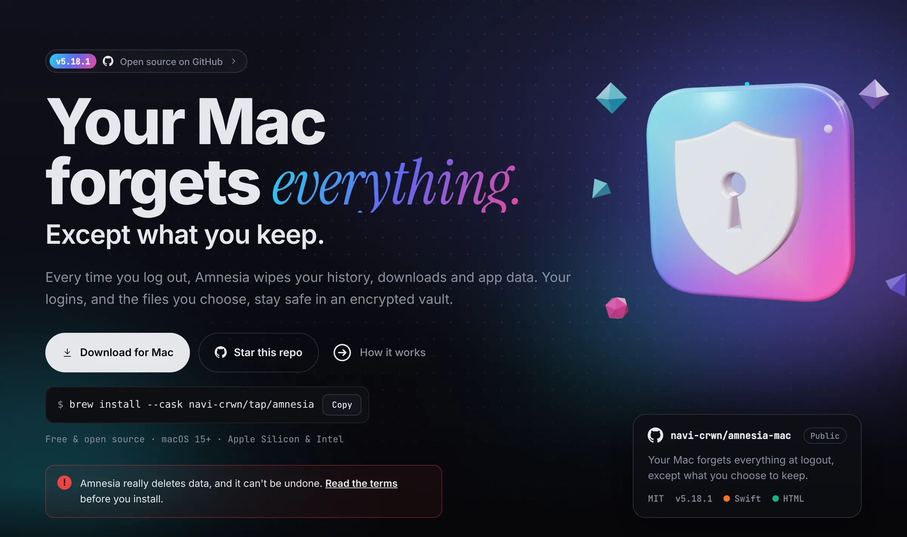
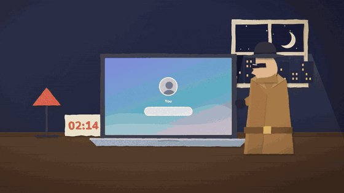
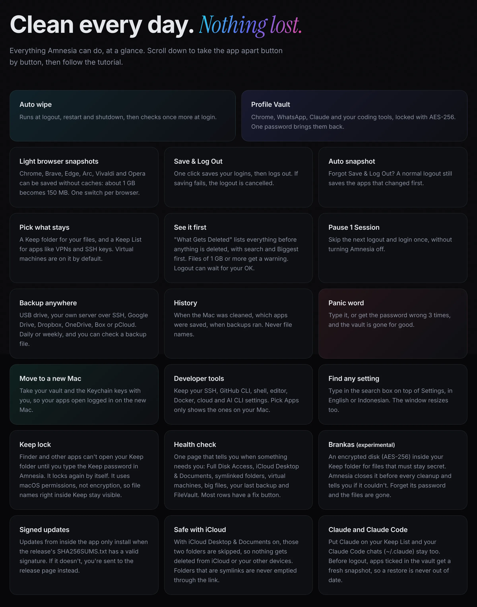
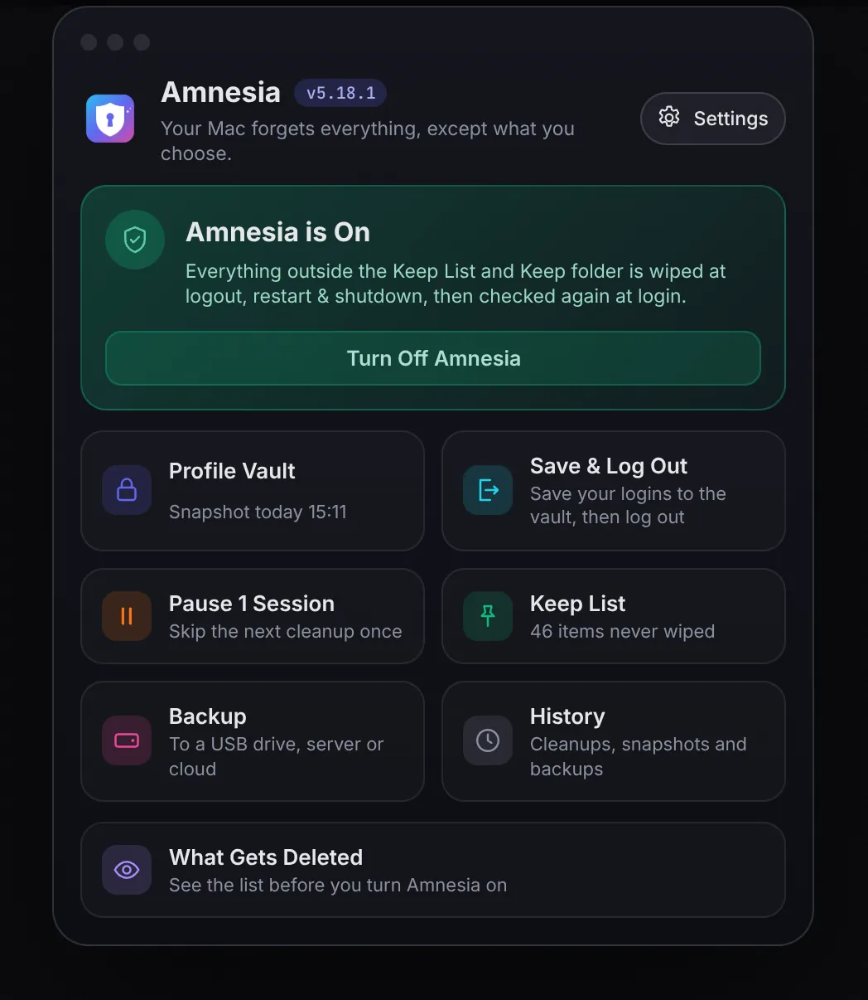
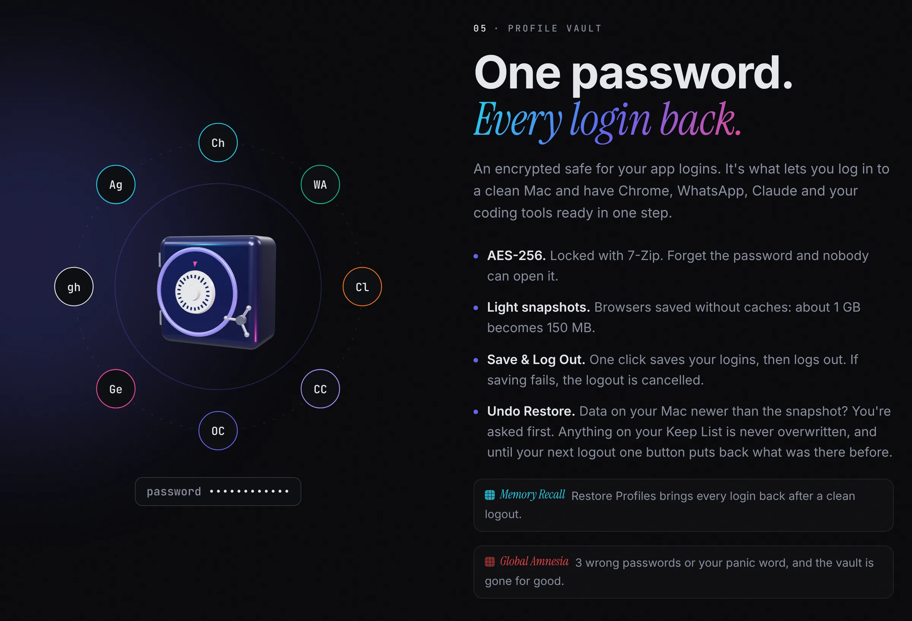
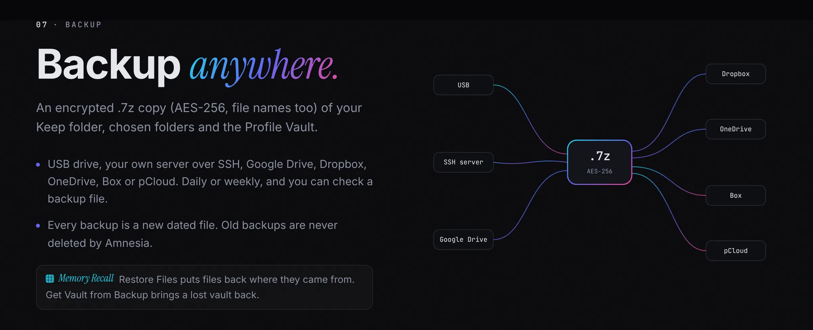
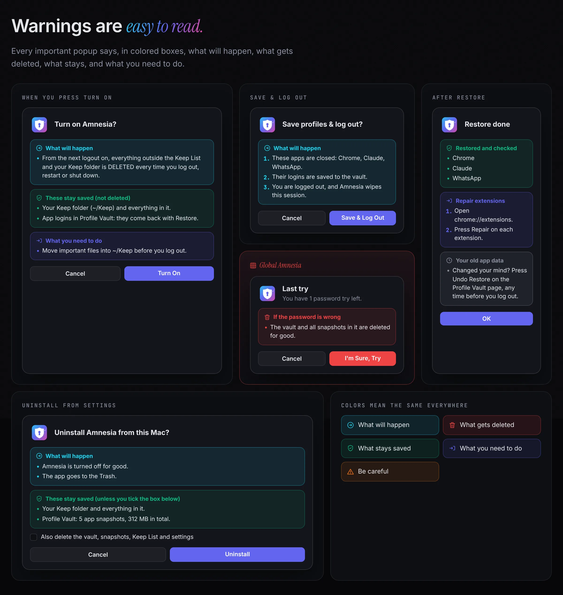
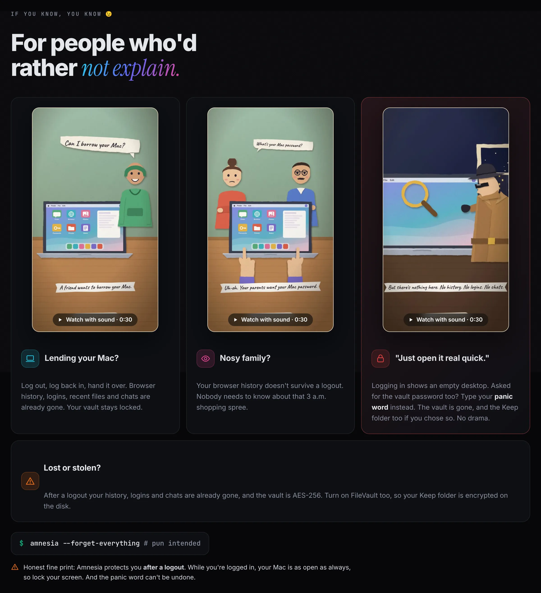

<p align="center">🌐 <b>English</b> · <a href="https://navi-crwn.github.io/amnesia/zh-cn/">简体中文</a> · <a href="https://navi-crwn.github.io/amnesia/de/">Deutsch</a> · <a href="https://navi-crwn.github.io/amnesia/id/">Bahasa Indonesia</a> · <a href="https://navi-crwn.github.io/amnesia/ja/">日本語</a> · <a href="https://navi-crwn.github.io/amnesia/pt-br/">Português (Brasil)</a> · <a href="https://navi-crwn.github.io/amnesia/es/">Español</a></p>

<p align="center"><picture><source media="(prefers-color-scheme: light)" srcset="docs/readme/hero-en-light.webp"></picture></p>

<p align="center">
  <b>Every time you log out, your Mac forgets everything.<br>Except the stuff you actually want to keep.</b>
</p>

<p align="center"><a href="https://navi-crwn.github.io/amnesia/#film"></a><br><sub>▶ Watch the full 54-second story, with sound, on the <a href="https://navi-crwn.github.io/amnesia/#film">website</a></sub></p>

<p align="center">
  <a href="../../releases/latest"><b>Download the app</b></a> ·
  <a href="https://navi-crwn.github.io/amnesia/">Website</a> ·
  <a href="https://navi-crwn.github.io/amnesia/win/">Windows</a> ·
  <a href="#install">Install</a> ·
  <a href="#faq">FAQ</a> ·
  <a href="#uninstall">Uninstall</a> ·
  <a href="CHANGELOG.md">Changelog</a> ·
  <a href="TERMS.md">Terms</a>
</p>

<p align="center"><sub>Latest: <b>Mac v5.26.0</b> · <b>Windows v0.11.0</b> · free and open source (MIT)</sub></p>

> [!WARNING]
> **Amnesia really deletes data.** Once you turn it on, everything outside your Keep folder and Keep List is deleted at every logout, restart and shutdown. It doesn't go to the Trash and can't be undone. Please read the short [terms & warning](TERMS.md) before you install.

---

## What is Amnesia?

Think of your Mac as a desk. When you're done for the day, Amnesia **clears the desk**: browser history, cookies, downloads, caches, Terminal history, all gone. Tomorrow you start fresh, with nothing left over from yesterday.

If everything is gone, you'd have to log back in to Gmail, WhatsApp, Telegram and the rest every day, which takes 15 to 20 minutes. So Amnesia comes with a **Profile Vault**, a locked safe for your logins. After you log in to your Mac, type **one password** and all your logins are back.

**Good for you if you:**
- share your Mac (or Windows PC), or use it in public places,
- don't want any trace of your work left behind,
- like a Mac that starts clean and light every day.

<p align="center"><picture><source media="(prefers-color-scheme: light)" srcset="docs/readme/features-en-light.webp"></picture></p>

<p align="center"><picture><source media="(prefers-color-scheme: light)" srcset="docs/readme/app-en-light.webp"></picture></p>

The full story, a click-along tutorial and the FAQ are on the website: [navi-crwn.github.io/amnesia](https://navi-crwn.github.io/amnesia/)

<details>
<summary><b>A closer look</b></summary>

<p align="center"><picture><source media="(prefers-color-scheme: light)" srcset="docs/readme/vault-en-light.webp"></picture></p>
<p align="center"><picture><source media="(prefers-color-scheme: light)" srcset="docs/readme/backup-en-light.webp"></picture></p>
<p align="center"><picture><source media="(prefers-color-scheme: light)" srcset="docs/readme/popups-en-light.webp"></picture></p>
<p align="center"><picture><source media="(prefers-color-scheme: light)" srcset="docs/readme/private-en-light.webp"></picture></p>

</details>

## What gets wiped, what stays?

| Wiped at every logout | Stays safe |
|---|---|
| Browser history & cookies | Everything in your **Keep folder** (`~/Keep` by default; put it anywhere, call it anything) |
| Desktop, Downloads, Documents, Pictures | Logins saved in the **Profile Vault** |
| Caches, logs, Terminal history | Everything on the **Keep List** (VPN, SSH keys, Terminal settings, etc.) |
| Data from apps you didn't pick | Apps in `/Applications` and Homebrew (unless you switch on *Remove apps installed later* under Advanced) |
| The Trash | Your Apple account, Notes, Mail, Messages and more (the **Apple accounts & data** card, on by default). Photos: a warning and a Keep button |
| | Virtual machines (UTM, Parallels, VirtualBox, VMware Fusion), after you press Keep on the warning |
| | Desktop and Documents when **iCloud Desktop & Documents** is on (wiping them would delete them from iCloud too) |

Want to see exactly what would go, **without deleting anything**? In the app, press **What Gets Deleted** on the home page. Or in Terminal:

```bash
bash ~/.amnesia/clean.sh logout --dry-run
```

## Features

- **Auto wipe.** Cleaning runs **before** your Mac logs out, restarts or shuts down. At the next login Amnesia checks again, so anything that slipped through gets cleaned too.
- **Profile Vault.** Your Chrome logins (Gmail, WhatsApp Web, Telegram Web), Claude, WhatsApp, and coding tools like Claude Code, OpenCode, Gemini CLI and GitHub CLI go into an encrypted safe (AES-256). One password brings them back. The page has three numbered steps in the order you use them: pick the apps, save them (Snapshot Now), and bring them back after you log in (Restore Profiles). Other Chromium browsers (Brave, Edge, Vivaldi, Arc, Opera) can be added with one tap, and so can Signal, Session, Element, Telegram, Obsidian, Notion, Zoom and Bitwarden. Amnesia also suggests other installed apps that look like they keep a login.
- **Restore asks before going back in time.** If an app's data on your Mac is newer than its snapshot, you're asked first. Anything on your Keep List is never overwritten by a restore. And until your next logout, **Undo Restore** on the vault page puts back what was there before.
- **Light snapshot, per browser.** In Profile Vault, step 1 → **Change…** has a **Light snapshot** switch for each browser. On (default): the browser's caches and the program files of Web Store extensions are skipped, so the snapshot is much smaller and faster; logins, bookmarks and settings are still saved, and after Restore you press *Repair* on each extension. Off: everything is saved. Save & Log Out and the auto snapshot follow the same switch.
- **Save & Log Out.** One click: your logins are saved to the vault first, then the Mac logs out. If saving fails, the logout is cancelled, so nothing gets lost.
- **Pause 1 Session.** Need to skip the wipe just once? Hit Pause. After one logout and login, Amnesia turns itself back on.
- **Keep List.** Pick the folders and apps that should never be wiped, right from the app. Switch an app on and you see exactly what's kept (app data, settings, sizes). Keeping **Claude** also keeps your Claude Code chats (`~/.claude`, `~/.claude.json`).
- **Keep lock.** Finder and other apps can't open or change your Keep folder until you type the Keep password in Amnesia. It locks again after 5 to 60 minutes, when the screen locks and at every logout. It uses macOS permissions rather than encryption, and file names right inside Keep stay visible. Off by default.
- **Brankas (experimental).** An encrypted disk (APFS, AES-256) inside your Keep folder for files that must stay secret. Amnesia closes it before every cleanup and tells you if it couldn't. Forget its password and the files are gone.
- **Health check.** One page in Settings: is Amnesia on, Full Disk Access, iCloud Desktop & Documents, symlinked folders, virtual machines, big files about to go, your last backup, Keep lock, the Brankas, FileVault, free disk space, memory and battery condition. Most rows have a fix button. Next to it, **Limitations** lists what Amnesia can't wipe (Time Machine, Spotlight, iCloud, swap, system logs, other accounts).
- **Care.** A page to free up space when you want, always with a list to check first: a read-only **Disk overview**, **Clean now** (caches, logs, Amnesia's trash; caches of open apps are skipped), **Uninstall apps** (to the Trash, personal data stays unless you tick it), **Project build folders** (node_modules, target, build, dist and more; folders used in the last 7 days or tracked by git are left alone), **Old installers** (.dmg, .pkg; disk images and virtual machines are never picked for you) and **Safe tune-ups** without an admin password. Nothing risky is ticked for you, and every run is in History with the space freed. Amnesia already wipes most of your home folder at logout, so Care mostly helps with your Keep folder, kept apps and big files from this session.
- **Stops when unsure.** If the Keep List can't be read or has gone missing, the cleanup deletes nothing and says so in History. A copy of your last good Keep List is kept to restore it. When a check can't tell (cloud, iCloud, links, owner), the item is kept.
- **Amnesia modes.** Pick how much is forgotten at every logout. **Retrograde Amnesia** is like a brand-new account at every login: only your Keep folder and what Amnesia needs to work stay. **Selective Amnesia** (recommended) is the basic list for a new install: your Keep folder, app logins from the vault, SSH keys, Git and shell settings. You add your own apps. **Partial Amnesia** lets apps keep their settings and logins in place, while your files, Downloads, Desktop, caches, logs, the Trash and shell history are wiped. Browsing history and cookies inside a browser's own folder stay too, because that folder is kept. **Custom Amnesia** is your own Keep List. Every switch shows a preview first (what will now be wiped, what will now be kept), warns you when more is wiped, and takes effect at the next logout. A mode only changes its own marked section of the Keep List, so your own lines stay. A missing or damaged mode file never empties your Keep List.
- **Vault profiles.** Restore only what you need, like **Work** or **Personal**, or everything. Rename, add and remove profiles. When one app is in two profiles, Amnesia says so: one browser holds one set of logins, so a second browser (or a separate browser profile) keeps personal use apart.
- **Ask an AI.** Get advice without sharing your files. Amnesia makes a report with no file contents and no names of your files (folder names can be hidden too), plus a ready prompt. Copy it or save it to your Keep folder, paste it into the AI you choose, then paste the answer back. Every suggested change gets a checkbox and the same preview as a mode switch; nothing is applied until you confirm, and Amnesia's own lines can't be removed this way. Amnesia makes no network calls for this.
- **Terminal command.** Switch it on in Settings and get a read-only `amnesia` command: `amnesia status`, `amnesia preview`, `amnesia report` (`--json`, `--hide-names`), `amnesia keep`, `amnesia history`. It never deletes or changes anything.
- **Your own Keep folder.** Files in it are never wiped. Put it anywhere (even on an external drive) and give it any name.
- **Backup anywhere.** Your chosen folders get locked into one `.7z` file (AES-256) and sent to:
  - a **USB drive / SSD** that's plugged in,
  - **your own server / VPS** over SSH + rsync. Type the server password once, Amnesia sets up the key. No Terminal.
  - the **cloud**: Google Drive, Dropbox, OneDrive, Box or pCloud. You log in through your browser, no Terminal needed. (S3, WebDAV and 40+ more work through rclone.)
- **Scheduled backups.** Daily or weekly, running on their own while the Amnesia icon is in the menu bar. **Run the scheduled backup now** tests it right away.
- **Check a backup file.** Pick a backup `.7z` and Amnesia opens it in a temporary folder to check that the vault inside can be restored. Nothing in your current vault changes. It tells you clearly if the password is wrong or the file has no vault inside.
- **Restore Files.** Pick files or folders from a backup and Amnesia puts them back where they came from. Anything already there is moved to `~/.amnesia/before-restore` first, never overwritten. Prefer another place? Press **To Another Folder**.
- **History.** A page that lists every cleanup, snapshot, restore and backup, grouped by day. Only times and app names, never your file names.
- **Move to a new Mac.** Take all your logins with you: the Keychain keys go into the vault, the vault goes into a backup, and you restore it on the new Mac.
- **Welcome tour.** The first time you open it, Amnesia shows you around, checks that everything's ready, finds your apps and asks which ones should keep their data.
- **Panic button.** Get the vault password wrong 3 times, or type your *panic word*, and the vault is destroyed on the spot.
- **Check before logout.** Logging out or restarting from the Apple menu? Amnesia holds on for a second and shows what's about to be deleted. You decide: continue or cancel. The list is prepared in the background, so it opens right away.
- **Offline & private.** No servers, no accounts, no tracking, no analytics. Nothing leaves your Mac unless you set up a backup yourself. The only thing Amnesia asks the internet is GitHub's newest version number (every week, 2 weeks or month, your pick), and you can switch that off.
- **Safe with iCloud and symlinks.** With iCloud Desktop & Documents on, those two folders are skipped, so nothing is deleted from iCloud or your other Apple devices. Folders that are symlinks are never emptied through the link. Files that couldn't be deleted are counted as "could not be deleted", never as cleaned.
- **Auto snapshot.** Forgot to press Save & Log Out? On a normal logout, restart or shutdown, Amnesia still saves the apps whose data **changed** since their last snapshot (at most 150 seconds, so the Mac doesn't hang). Apps you switched off in the vault are skipped. If it runs out of time, the older snapshot of that app stays. It also runs when you made a snapshot just a few minutes earlier, so work done after a manual snapshot isn't lost.
- **Clear warnings.** Every popup is split into colored boxes: *What will happen* (blue), *What gets deleted* (red), *These stay saved (not deleted)* (green) and *What you need to do* (purple).
- **Notifications.** After login, Amnesia tells you the Mac is clean and reminds you to restore your profiles.
- **Settings.** Turn any of the above on or off. **Run in the background** keeps Amnesia as just the menu bar icon at login, no window. A Keep alias on the Desktop and Keep in the Finder sidebar come back after every cleanup (both can be switched off), and the menu bar panel has **Open Keep**.
- **Advanced.** Settings that need a bit of thought live together on one page: **log out when the Mac is left alone** (5 to 60 minutes, with a 60-second countdown you cancel by touching anything), **remove apps installed later** (apps you install after switching it on go at logout, unless you press Keep; apps installed with an admin password are left alone), the panic word and Move to a New Mac.
- **Signed updates from the app.** Amnesia checks GitHub on the schedule you pick, downloads the new version, checks it against `SHA256SUMS.txt` **and** the developer's signature on that file (`SHA256SUMS.txt.sig`, ECDSA P-256), and installs it when you press **Install & Reopen**. Without a valid signature it installs nothing and opens the release page instead. Installed with Homebrew? Then `brew upgrade` stays the way to update.
- **FileVault check.** The Health check shows whether disk encryption is on. Amnesia only wipes at logout and your Keep folder isn't encrypted, so FileVault is strongly recommended.
- **Two languages.** English or Bahasa Indonesia, pick one in Settings.
- **Menu bar icon.** You can always see Amnesia's status in the top right: green is on, orange is paused, red is off. The big **Turn On / Turn Off** button sits right on the status card of the home page.

## Amnesia for Windows

Amnesia also runs on **Windows 10 and 11** (x64 and ARM). It's an official release now, **v0.11.0**, built from the `windows/` folder. Same idea, made for Windows:

- wipes your user folder and Windows traces (recent files, jump lists, Explorer and search history, clipboard history and more) at **sign out, restart and shutdown**, and checks again at sign in
- Keep folder and Keep List with app icons, one-click **Keep an app**, and a 3-day trash for apps you remove
- Profile Vault, backups, Health check, Keep lock, an experimental Safe box, panic hotkey, USB key, sign out when idle
- cloud folders (OneDrive, Dropbox, Google Drive, iCloud Drive and more) and virtual machines are never wiped
- **Care**: free up space with a list to check first (Temp, app caches, build folders, old installers to the Recycle Bin, uninstall programs installed just for you)
- **Amnesia modes** (Retrograde Amnesia, Selective Amnesia, Partial Amnesia, Custom Amnesia) with a preview before every switch, **vault profiles** to restore only what you need, and **Ask an AI** for advice without sharing your files
- installs just for you (no admin), signed in-app updates

Get `Amnesia-Setup-<version>-x64.exe` (or `-arm64.exe`) from the **Windows** release (tags start with `win-v`) on the [Releases](../../releases) page, and check it against `SHA256SUMS.txt`. There's no paid code signing certificate, so SmartScreen warns the first time: **More info → Run anyway**.

More: the [Windows website](https://navi-crwn.github.io/amnesia/win/) and [windows/README.md](windows/README.md).

## Install

**You need:** macOS 15 or newer. Everything else is inside the app (7-Zip included). The welcome tour helps you install Apple's free Command Line Tools if they're missing, and asks once for **Full Disk Access** (so macOS doesn't ask about every folder).

**Only get Amnesia from** [github.com/navi-crwn/amnesia](https://github.com/navi-crwn/amnesia), its website [navi-crwn.github.io/amnesia](https://navi-crwn.github.io/amnesia/) (GitHub Pages) or the Homebrew tap `navi-crwn/tap`. Copies anywhere else are not from us. Found a security problem? See [SECURITY.md](SECURITY.md).

**Before anything else:** read the [terms & warning](TERMS.md). The app also asks you to tick that you've read it.

**Option 1: Homebrew** (easiest, and updates come with `brew upgrade`)

```bash
brew install navi-crwn/tap/amnesia
```

**Option 2: Installer (.dmg)**

1. Grab `Amnesia-vX.dmg` from [Releases](../../releases/latest), open it, and drag **Amnesia** onto the **Applications** folder. The `READ ME FIRST` file in there has the short warning.
2. The app isn't signed by Apple (yet), so macOS blocks it the first time. Open it once, then go to **System Settings → Privacy & Security** and click **Open Anyway**.
   Or in Terminal: `xattr -dr com.apple.quarantine /Applications/Amnesia.app`
3. Want to check the download? Every release has `SHA256SUMS.txt` (and its signature `SHA256SUMS.txt.sig`). Compare with `shasum -a 256 ~/Downloads/Amnesia-v*.dmg`.

**Option 3: Build it yourself** (needs the Command Line Tools)

```bash
git clone https://github.com/navi-crwn/amnesia.git ~/.amnesia
bash ~/.amnesia/app/build.sh
```

**Uninstalling:** open Settings and press *Uninstall Amnesia*. See [Uninstall](#uninstall) below.

## First-time setup

The welcome tour walks you through this, but here's the short version:

1. **Create the vault.** Open *Profile Vault*, pick a password (at least 12 characters), then press *Create Vault*. This password **can't be recovered** if you forget it, so keep it somewhere safe.
2. **Save your logins.** Log in to Chrome, WhatsApp and your other apps like normal. In Profile Vault, check the apps in step 1, then press *Snapshot Now* in step 2.
3. **Protect your files.** Move anything important into your Keep folder (`~/Keep`, or wherever you put it).
4. **Double-check.** Open Settings (⚙️) → **See what would be deleted now**, and make sure nothing important is on the list.
5. **Turn it on.** Press *Turn On* on the home page's status card. From the next logout on, your Mac always starts clean.

**Day to day:** log out with **Save & Log Out**. When you log back in, open Profile Vault, type your password in step 3 and press **Restore Profiles**.

## Glossary

These words are only used in this text and on the website. The buttons in the app keep their normal names.

- **Selective Amnesia**: the normal cleanup at logout. Everything is wiped except your Keep List, your Keep folder and the Profile Vault.
- **Global Amnesia**: everything is gone with no way back. This happens with the panic button (Doomsday), with Uninstall when you tick *delete the vault too*, or with a wipe when you have no snapshot and no backup.
- **Memory Recall**: bringing things back. That's Restore Profiles, Get Vault from Backup, Move to a New Mac and Restore Files.

## FAQ

**What's the difference between the Keep List and the Profile Vault?**
The Keep List is for stuff that isn't secret and can just stay (like VPN settings). The Profile Vault is for logins and personal data: it's locked, and only opens with your password.

**What if I log out from the Apple menu?**
That's fine. Amnesia holds on for a moment to show you what will be deleted, then saves your logins to the vault before cleaning up. You can turn both of these off in Settings.

**Is my Keep folder encrypted?**
Not by Amnesia. Keep lock stops Finder and other apps from opening it, but it's macOS permissions, not encryption. Turn on FileVault so the whole disk is encrypted, and put files that must stay secret in the Brankas.

**I restored by mistake and my newer data went back. Now what?**
Press **Undo Restore** on the Profile Vault page, any time before you log out. Since v5.23 Amnesia also asks first when an app's data is newer than its snapshot.

**What if I forget the vault password?**
Then nobody can open the vault, including you. Delete it, make a new one, and log back in to your apps.
If you still know it and just want a new one: Profile Vault → **Password**. Your snapshot stays.

**Does Snapshot ask for my password?**
No. The vault locks snapshots with a key that only your password can open, so saving needs no password; only **Restore** does. Every app has its own snapshot, so saving one app never overwrites another; only the newest one per app is kept. You choose which apps (and folders) go in it on the Profile Vault page, which also shows their sizes. The trash icon next to a snapshot deletes just that one; **Delete All Snapshots** removes them all but keeps your vault and password. Snapshot, Restore and Backup can be cancelled; your previous one stays safe.

**Does my data get sent to the internet?**
No. Amnesia has no servers, no accounts, no tracking and no analytics, so there's nothing to send. The only exception is a backup to a server or cloud that **you** set up, and even then only the locked `.7z` file goes, straight from your Mac to the place you picked. Your vault, your Keep List and your settings never go to GitHub either.

**Why does it want Full Disk Access?**
To clean your Desktop, Documents and Downloads, macOS would otherwise ask permission folder by folder (and it can't ask during a logout). Allow it once in **System Settings → Privacy & Security → Full Disk Access** and you're done. If you build the app yourself, `build.sh` signs it with a local certificate so the permission survives updates (the first build may ask for your Mac password once: press **Always Allow**). The wiping at logout runs through the app too, so the same permission covers it.

**What do I need for online backups?**
- *Flash drive or folder:* pick the drive or any folder (for example a network drive).
- *SSH server:* type `user@host` or `user@host:folder` (another port: fill in the Port box, or type `user@host:port`), type the server password **once**, press **Connect**. Amnesia makes an SSH key and installs it on the server for you, no Terminal. The password isn't saved; from then on backups log in with the key. Already have a key that works? Leave the password empty. Without a folder, backups go to `~/amnesia-backup` on the server. Connect checks that the folder can be written to, shows its full path, and measures the speed so you know roughly how long a backup takes.
- *Cloud:* 1. pick your service (Dropbox, OneDrive, Box or pCloud), 2. press **Connect**: the login page opens in your default browser (Safari if you haven't picked one). Log in and press Allow, 3. type a folder name. If the browser doesn't open, the waiting screen has a button to open the login page. Amnesia installs rclone for you (needs Homebrew).
- *Google Drive:* easiest with the free **Google Drive for Desktop** app: Amnesia copies the backup into its folder and the app uploads it. Prefer a direct connection? Use your own Google client ID under **Advanced** (the app has a step-by-step guide).

**How backup works (guide)** on the Backup page explains each destination, which folders are safe, and how to check your backup file.

If you change your server password later, backups keep working (they use the key). Only if the server is reinstalled or the key is removed will a backup fail, and the message tells you to press **Connect** again.

Every backup is uploaded in full, because the file is encrypted and can't be updated piece by piece. Old backups aren't deleted automatically, so clean them up at the destination now and then.

**How do I open a backup file?**
Double-clicking it opens Archive Utility, which can't open this kind of locked `.7z`. Use **Keka** (free), or Terminal: `~/.amnesia/bin/7zz x amnesia_backup_xxx.7z`, then type your backup password when it asks (don't put the password in the command). Easier still: Backup → **Restore Files** in the app.

**How do I get a few files back from a backup?**
Backup → **Restore Files…**: pick the `.7z`, type the backup password, tick what you want back and press **Restore to Original Place**. Files that are already there are moved to `~/.amnesia/before-restore/` first. If the original place is an external drive that isn't plugged in, Amnesia asks you for another folder. Note: while Amnesia is on, restored files outside your Keep List are wiped again at the next logout, so move them into your Keep folder.

**Check a backup file says "no Profile Vault". Is my backup broken?**
No. The file opens fine; it was just made with *Include Profile Vault* off (or before v5.13). Your files are in it, only the vault isn't. If it says the password doesn't match, the file is fine too, the password is just a different one.

**The scheduled backup asks for my Mac password. Why?**
The saved backup password sits in the Keychain, and an older version of the app saved it. Type your Mac password once and press **Always Allow**; Amnesia then saves it again under the current version, so it stops asking.

**Moving to a new Mac, what are the steps?**
Open Profile Vault → **Move to a New Mac** (or Settings). The page walks you through it:
1. On the old Mac: **Prepare Move** (click *Always Allow* in the macOS popups).
2. Back up with **Include Profile Vault** ticked.
3. On the new Mac: install Amnesia, open the Move page → **Get Vault from Backup**.
4. Press **Restore Profiles**, then **Restore Keys**. Chrome, Claude and WhatsApp open with your old logins.

**Can I check that a backup really works?**
Yes. Backup → **Check a backup file**: pick the `.7z`, type the backup password, and Amnesia unpacks the vault into a temporary folder, shows its size, date and apps, then deletes the temporary copy. Your current vault isn't touched.

**Where can I see what Amnesia did?**
Home → **History**. It lists cleanups (how many items), pauses, snapshots, restores, backups and the panic button, per day. File names are never written.

**How do I turn it off?**
Press *Turn Off* on the home page's status card. Your Mac stops being wiped until you turn it back on.

## Uninstall

The easy way: open **Settings** in the app and press **Uninstall Amnesia**. It goes in steps:
1. A popup explains what will happen and lists what's still stored (your vault, its snapshots, Keep List and settings).
2. A checkbox **Also delete the vault, snapshots, Keep List and settings** (unticked by default). Leave it unticked to keep them for later.
3. If you ticked it, a second confirmation asks once more. Those files go to the Trash, not deleted right away.
4. Amnesia turns off for good and moves the app to the Trash. Your Keep folder is never touched.

Keep lock on? Amnesia asks the Keep password and unlocks Keep first. Without it, Keep stays locked and you get the command that opens it: `chmod -RN ~/Keep`.

Dragged Amnesia to the Trash anyway? That's safe too: Amnesia notices, turns itself off and wipes nothing anymore.

Prefer Terminal? Paste this:

```bash
bash ~/.amnesia/uninstall.sh
```

It turns off the login agent first (so stopping it can't wipe anything), stops Amnesia, removes the app and checks that nothing is left. Your vault and settings in `~/.amnesia` stay, in case you come back. Your Keep folder is never touched.

- Want everything gone, vault included? Use `bash ~/.amnesia/uninstall.sh --all` (it asks you to type `DELETE` first).
- Installed with Homebrew? `brew uninstall amnesia` does the same safe steps.
- No `~/.amnesia` folder? Then Amnesia never ran, and the script isn't needed: just delete the app.

## Under the hood

| File | What it does |
|---|---|
| `clean.sh` | The main wiper. Reads `keep.conf` (your Keep List). |
| `agent.sh` | Started by macOS at login, then waits to clean up at logout. |
| `vault.py` | Profile Vault: RSA-4096 key + 7-Zip AES-256. |
| `backup.sh` | Encrypted backups to a USB drive, an SSH server, or the cloud (rclone). |
| `keep.example.conf` | Example Keep List. `build.sh` copies it to `keep.conf` on first install. |
| `app/` | The SwiftUI app, the icon, and the build/release scripts. `app/screenshots.sh` takes screenshots of the real app with demo data (optional). |
| `docs/` | The website (GitHub Pages). `docs/readme/` holds the README images, drawn from the website. |
| `presets/` | The Amnesia modes: `full.conf`, `balanced.conf`, `light.conf`. A mode copies one of them into a marked section at the top of `keep.conf`. |
| `report.py`, `bin/amnesia` | The Ask an AI report (no file contents, no file names) and the read-only `amnesia` Terminal command. |
| `keeplock.sh` | Keep lock and the Brankas (encrypted disk inside Keep). |
| `windows/` | The Windows version (**v0.11.0**): C# .NET 8 tray app + HTML pages, vault, backup, Health check and a Setup.exe with signed in-app updates. It really wipes once turned on, so check What gets wiped first. Built and tested by GitHub Actions (`.github/workflows/windows.yml`); a `win-v*` tag makes the Windows release. |
| `SECURITY.md`, `llms.txt` | How to report a security problem, and a short guide for AI assistants that help someone install Amnesia. |
| `test_clean.sh`, `test_vault.py`, `test_backup.sh`, `test_report.py` | Automatic tests in a fake home folder, safe to run anytime. |

---

<p align="center">MIT License · <a href="TERMS.md">Terms & warning</a> · Amnesia really deletes your data.</p>
